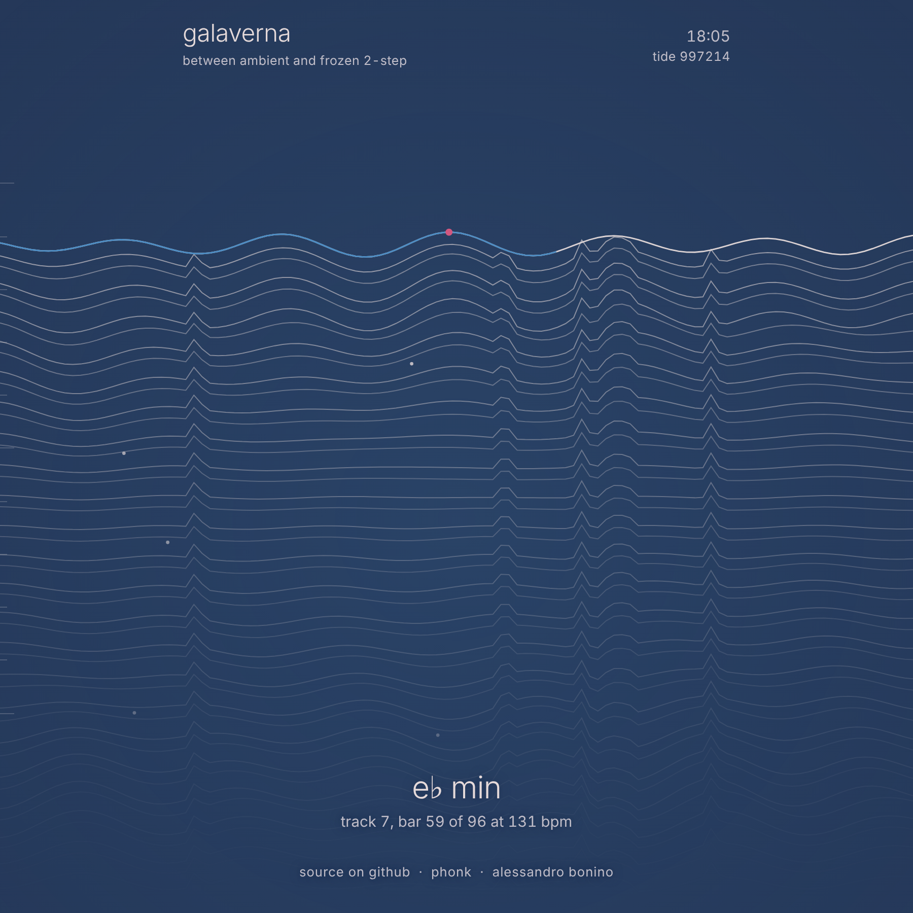

# galaverna

*between ambient and frozen 2-step*

A radio with one programme, cold. It is always on air, and whoever tunes in, anywhere, hears the same bar of the same track at the same moment. There is no stream and no server: everything is generated in real time, in your browser. One HTML file, no samples, no dependencies, no install.

Galaverna is the Italian word for hoarfrost: the ice that fog leaves on branches.

**▶ Tune in: [phonk.github.io/galaverna](https://phonk.github.io/galaverna/)**

## Listen

Tap the page to tune in, tap again to tune out. There is nothing else to set.

Every half hour of the clock is one tide. At low tide the music is still: pads held off the ground, wind, glass, a slow pulse on the sub. As it rises the hats start to skip, then a snare on two and four, then a kick that never falls where a straight beat would put it, with a sub under it. Then it all falls back.

Top right is the station clock: the number of the tide on air and how far into it we are. It is the same on every screen.

## How it stays the same for everyone

It works like [etere](https://phonk.github.io/etere/). Every half hour of the world clock has a number, and that number is the seed of everything played in it. When you tune in, the page works out which tide the clock says we are in, replays it silently from its beginning up to this moment, and goes live from there. Two people listening are as close together as their clocks are.

## What you see

A tide gauge. The blue line is the water: it stands where the tide is, and its shape is the chord that is sounding. Everything the music does leaves a line behind at that level, and the lines sink and fade. The kicks leave their notches, the glass leaves grains of frost.

## Notes

- It keeps playing with the phone screen off.
- English interface. Made by [Alessandro Bonino](https://alessandrobonino.com/) with Claude.
